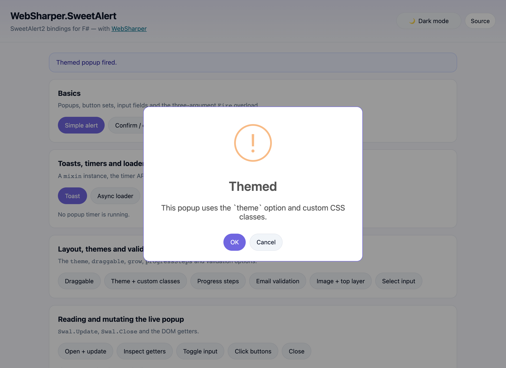

# WebSharper.SweetAlert

[](https://www.nuget.org/packages/WebSharper.SweetAlert)

WebSharper bindings for [SweetAlert2](https://sweetalert2.github.io/) — beautiful,
responsive, accessible replacement for JavaScript's popup boxes — for F# and C#
web apps.

The binding is **npm-based**: it imports the `sweetalert2` ES module
(`import Swal from "sweetalert2"`) and your toolchain bundles it (the sample uses
esbuild). There is no CDN `<script>` tag.

This repository contains:

| Project | Purpose |
| --- | --- |
| `WebSharper.SweetAlert` | The binding: the complete SweetAlert2 11.26 API surface — options, result types, icons, input types, themes, positions, grow directions, `Swal` and the instance type returned by `Swal.Mixin`. |
| `WebSharper.SweetAlert.Sample` | A static WebSharper SPA (esbuild → `dist/`) that exercises the whole binding: every option group, the timer API, `preConfirm` loaders, DOM getters, `Swal.Update`/`Swal.Close`, declarative templates and the lifecycle event emitter. |

## Bound npm package

The binding covers `sweetalert2` `>= 11.26.25 < 12.0.0`. The sample also bundles
`esbuild` and relies on SweetAlert2's built-in stylesheet (the `sweetalert2` ESM
entry injects the CSS).

## Live demos

**Try it live:** [Open the sample in your browser](https://dotnet-websharper.github.io/sweetalert/)



The sample doubles as the binding's [test case](#running-the-test-case): it
fires popups with every option group (content, buttons, inputs and validation,
layout, themes and custom classes, progress steps, draggable and grow), drives
the timer API, `preConfirm` loaders, the loader and validation-message helpers,
the DOM getters, `Swal.Update`/`Swal.Close`, `Swal.Mixin` instances,
`Swal.BindClickHandler` with declarative `<template>` popups, the parameter
queries and `Swal.On`/`Once`/`Off` lifecycle events. It is light-themed by
default and has a light/dark theme switcher (persisted in `localStorage`) that
also switches the SweetAlert2 `theme` option.

- **Sample (this repository):** <https://dotnet-websharper.github.io/sweetalert/>
- **Source repository:** <https://github.com/dotnet-websharper/sweetalert>
- **WebSharper bindings:** <https://websharper.com/bindings>

## Install

```bash
dotnet add package WebSharper.SweetAlert
```

Or with Paket:

```fsharp
nuget WebSharper.SweetAlert
```

The package targets `netstandard2.0` and works with any WebSharper 11 project.
It declares its npm dependency (`sweetalert2` `>= 11.26.25 < 12.0.0`), so
WebSharper's SPA/esbuild build pulls it in automatically.

## Usage

All types live in the `WebSharper.SweetAlert` namespace. `Swal` is the default
export, `Swal.Mixin` returns a `SweetAlertInstance` with the same API and default
options baked in.

### Firing a popup

```fsharp
open WebSharper.JavaScript
open WebSharper.SweetAlert

// With an options object; the generic argument is the type of result.Value.
promise {
    let! result =
        Swal.Fire<string>(SweetAlertOptions(
            TitleText = "Your name",
            Text = "Hello! Please say something.",
            Icon = SweetAlertIcon.Info,
            Input = SweetAlertInput.Text,
            InputPlaceholder = "At least 3 characters",
            ShowCancelButton = true,
            InputValidator = (fun (value: obj) ->
                let text = As<string> value
                if isNull text || text.Trim().Length < 3 then
                    box "Please type at least 3 characters"   // keeps the popup open
                else
                    box "")                                   // empty/falsy accepts the value
        ))

    if result.IsConfirmed then
        Console.Log("Hello, " + result.Value)
    elif result.IsDismissed then
        Console.Log("Dismissed: " + As<string> result.Dismiss)
}
|> ignore

// The short form: title, HTML body, icon.
Swal.Fire<unit>("The Internet?", "That thing is still around?", SweetAlertIcon.Question)
|> ignore
```

`SweetAlertResult<'T>` exposes `IsConfirmed`, `IsDenied`, `IsDismissed`,
`Value` and `Dismiss` (`DismissReason.Cancel`, `.Backdrop`, `.Close`, `.Esc`,
`.Timer`).

### Options

`SweetAlertOptions` mirrors the TypeScript `SweetAlertOptions` shape:

- **Content** — `Title`/`TitleText`, `Text`, `Html`, `Footer`, `Icon`
  (`Success`, `Error`, `Warning`, `Info`, `Question`), `IconColor`, `IconHtml`,
  `ImageUrl`/`ImageWidth`/`ImageHeight`/`ImageAlt`, `Template`.
- **Layout** — `Position` (`SweetAlertPosition.TopStart` … `.BottomRight`),
  `Grow` (`Row`, `Column`, `Fullscreen`, `False`), `Width`, `Padding`, `Color`,
  `Background`, `Backdrop`, `Target`, `HeightAuto`, `ScrollbarPadding`,
  `TopLayer`.
- **Behaviour** — `Toast`, `Draggable`, `Animation`, `Theme`, `Timer`,
  `TimerProgressBar`, `AllowOutsideClick`, `AllowEscapeKey`,
  `StopKeydownPropagation`, `KeydownListenerCapture`.
- **Buttons** — `ShowConfirmButton`/`ShowDenyButton`/`ShowCancelButton`, the
  button texts, colors and ARIA labels, `ButtonsStyling`, `ReverseButtons`,
  `FocusConfirm`/`FocusDeny`/`FocusCancel`, `ReturnFocus`, `ShowCloseButton`,
  `CloseButtonHtml`/`CloseButtonAriaLabel`, `LoaderHtml`,
  `ShowLoaderOnConfirm`/`ShowLoaderOnDeny`, `PreConfirm`, `PreDeny`.
- **Input** — `Input` (`SweetAlertInput.Text`, `.Email`, `.Password`, `.Number`,
  `.Tel`, `.Search`, `.Range`, `.Textarea`, `.Select`, `.Radio`, `.Checkbox`,
  `.File`, `.Url`, `.Date`, `.DateTimeLocal`, `.Time`, `.Week`, `.Month`),
  `InputLabel`, `InputPlaceholder`, `InputValue`, `InputOptions`,
  `InputAutoFocus`, `InputAutoTrim`, `InputAttributes`, `InputValidator`,
  `ReturnInputValueOnDeny`, `ValidationMessage`.
- **Progress steps** — `ProgressSteps`, `CurrentProgressStep`,
  `ProgressStepsDistance`.
- **Lifecycle hooks** — `WillOpen`, `DidOpen`, `DidRender`, `WillClose`,
  `DidClose`, `DidDestroy`.
- **Styling** — `CustomClass` (`SweetAlertCustomClass` with a field per popup
  part), `ShowClass`, `HideClass`.

`SweetAlertUpdatableParameters` is the subset accepted by `Swal.Update` (the
same fields, typed separately, matching the TypeScript
`SweetAlertUpdatableParameters` union).

### Theming

`Theme` takes a `SweetAlertTheme`: `Light`, `Dark` and `Auto` are part of the
core stylesheet; the named themes (`Minimal`, `Borderless`, `Bootstrap4`/`5`,
`MaterialUi`, `EmbedIframe`, `Bulma` and their light/dark variants) additionally
need the matching `sweetalert2/themes/<theme>.css` stylesheet.

### Reusable instances

```fsharp
let toast =
    Swal.Mixin(SweetAlertOptions(
        Toast = true,
        Position = SweetAlertPosition.TopEnd,
        Timer = 3000,
        TimerProgressBar = true,
        ShowConfirmButton = false
    ))

toast.Fire<unit>(SweetAlertOptions(TitleText = "Saved", Icon = SweetAlertIcon.Success))
|> ignore
```

`Swal.Mixin` returns a `SweetAlertInstance`: the same `Fire`, `Update`, `Close`,
getters, timer API and event helpers, as instance members.

### The live popup

```fsharp
Swal.IsVisible()                     // bool
Swal.Update(SweetAlertUpdatableParameters(TitleText = "Updated title", Icon = SweetAlertIcon.Success))
Swal.Close()                         // resolves the promise with an empty result
Swal.Close(SweetAlertPartialResult<unit>(IsConfirmed = true))

Swal.ShowLoading()
Swal.HideLoading()
Swal.IsLoading()                     // bool
Swal.ShowValidationMessage("Looks wrong")
Swal.ResetValidationMessage()
Swal.EnableButtons(); Swal.DisableButtons()
Swal.EnableInput(); Swal.DisableInput()
Swal.ClickConfirm(); Swal.ClickDeny(); Swal.ClickCancel()

// DOM getters (return the element, or null while no popup is open)
Swal.GetContainer(); Swal.GetPopup(); Swal.GetTitle(); Swal.GetHtmlContainer()
Swal.GetImage(); Swal.GetCloseButton(); Swal.GetIcon(); Swal.GetIconContent()
Swal.GetConfirmButton(); Swal.GetDenyButton(); Swal.GetCancelButton()
Swal.GetActions(); Swal.GetFooter(); Swal.GetTimerProgressBar()
Swal.GetProgressSteps(); Swal.GetValidationMessage(); Swal.GetInput()
Swal.GetFocusableElements()          // HTMLElement[]

// Timers: Optional<int> / Optional<bool>
Swal.GetTimerLeft(); Swal.StopTimer(); Swal.ResumeTimer(); Swal.ToggleTimer()
Swal.IncreaseTimer(2000); Swal.IsTimerRunning()
```

### Lifecycle events and declarative popups

```fsharp
Swal.On(SweetAlertEventName.DidOpen, fun () -> Console.Log "opened")
Swal.Once(SweetAlertEventName.DidClose, fun () -> Console.Log "closed once")
Swal.Off()                                   // or Off(event[, handler])

Swal.BindClickHandler()                      // data-swal-template="#my-template"
Swal.Fire<unit>(SweetAlertOptions(Template = "#my-template"))
|> ignore

Swal.IsValidParameter("theme")               // bool
Swal.IsUpdatableParameter("icon")            // bool
let options = Swal.ArgsToParams([| "Title"; "Body"; "success" |])
```

`BindClickHandler` is called after the page template is bound (the declarative
triggers live in the DOM after `.Bind()`).

### Notes on the API

- `InputValidator`, `PreConfirm` and `PreDeny` are typed as `obj -> obj`: return
  a value (or a `Promise<obj>`) from them, and return a truthy validation
  message to keep the popup open.
- `Swal.Close` accepts a `SweetAlertPartialResult<'T>` (all fields optional), so
  you can resolve the popup's promise with only the fields you care about.
- The timer methods return `Optional<int>` (`Undefined` when no timer is set).
- `Swal.DismissReason` is available as the `DismissReason` type; its values are
  the strings `cancel`, `backdrop`, `close`, `esc` and `timer`.
- Compared to the earlier 11.7 release of this binding: `SweetAlertPosition`
  members lost their mangled names (`Top_start` → `TopStart`), `IsLoading`
  returns `bool` (it was `unit`), the timer methods return `Optional` values,
  and `Close` no longer requires a complete result — the additions are the
  `Question` icon, the new input types, `Theme`, `Draggable`, `Animation`,
  `Grow`, `TopLayer`, `ShowValidationMessage`, `EnableButtons`/`DisableButtons`,
  `ShowLoading`, `IsLoading`, `BindClickHandler`, `IsValidParameter`,
  `IsUpdatableParameter`, `ArgsToParams`, `On`/`Once`/`Off` and `Mixin`
  instances.

## Running the test case

The sample is the binding's test case. Restore the tools and packages, then
build the sample in Release:

```bash
dotnet tool restore
dotnet paket restore
dotnet build WebSharper.SweetAlert.Sample/WebSharper.SweetAlert.Sample.fsproj -c Release
```

The build produces a static site in `dist/` (the `ESBuildBundle` target runs
`npm install` and esbuild). Serve it with
[`dotnet serve`](https://github.com/dotnet-serve/dotnet-serve):

```bash
dotnet tool install -g dotnet-serve   # once
dotnet serve -d dist -p 8080
```

Then open <http://localhost:8080> and click through the demo cards.

## Build from source

```bash
./build            # debug build of the binding and the sample
./build CI-Release # the build stack's release target
./build WS-Package # pack the binding (WSPackageFolder=... to choose the output)
```

On Windows use `build.cmd` with the same targets.

## Pack

```bash
WSPackageFolder=/tmp/pkg ./build WS-Package
```

The package contains the binding assembly, its XML documentation and the
WebSharper 11 `.websharper` sidecar. The version is derived from the
`WebSharper` package version.

## Deployment

`.github/workflows/ghpages.yml` builds the sample on the default branch with
.NET 11 and Paket, and publishes `dist/` to GitHub Pages.

## Repository layout

| Path | Contents |
| --- | --- |
| `WebSharper.SweetAlert/` | The binding (`Main.fs`, `WebSharperProject=binding`) |
| `WebSharper.SweetAlert.Sample/` | The sample SPA (`Client.fs`, `index.html`, `site.css`, esbuild config) |
| `nuget/` | The Paket pack template |
| `docs/sample.png` | Screenshot of the sample (light theme) |
| `.github/workflows/ghpages.yml` | Build + GitHub Pages deployment |

## License

Apache 2.0 — see [LICENSE.md](LICENSE.md).